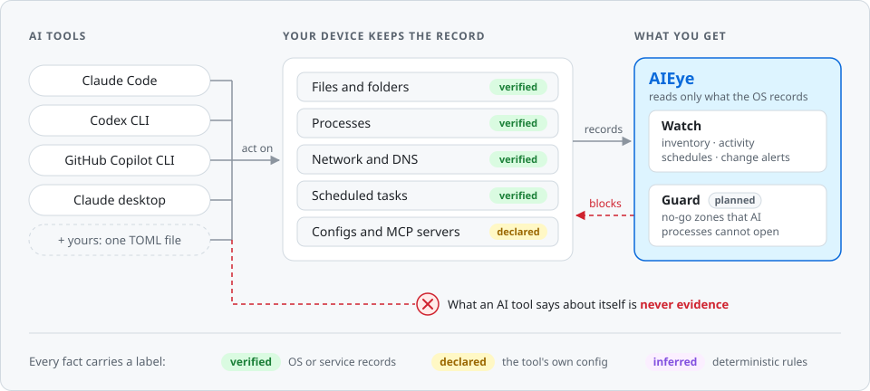

# AIEye

**Antivirus for the age of AI agents.**

[](https://github.com/goreski/aieye/actions/workflows/ci.yml)

<picture>
  <source media="(prefers-color-scheme: dark)" srcset="docs/images/overview-dark.svg">
  
</picture>

Your AI tools can read your folders, run scheduled tasks while you sleep and act on your mail, calendar and drive. AIEye shows what they can reach and what they actually did, and keeps them out of places they must never touch.

It follows one rule:

> **AIEye trusts only what the operating system and the accessed services record. What an AI tool says about itself is never evidence.**

## Why

- Each AI vendor shows only its own slice of what its tool can do, as a list it reports itself.
- The tools that cover this today (MCP gateways, SaaS security platforms) are built for enterprise security teams and see only the traffic routed through them.
- Nobody gives an individual, or a small team, one independent answer to *"what can AI touch on this machine, and what did it do?"*

AIEye works like antivirus, with two parts:

| | What it does | Default |
|---|---|---|
| **Watch** | Lists AI tools, the folders, MCP servers and accounts they can reach, what they opened and contacted, and what runs on a schedule. Alerts when any of this changes. | Always on |
| **Guard** | No-go zones (SSH keys, password vaults, `.env` files, your own folders) that the OS keeps AI processes out of. | Opt-in per zone |

## What a scan looks like

On the development machine, one `aieye scan` finds 4 AI tools: 16 install traces and 23 AI processes running right now. Every finding is a record like this one:

```json
{
  "device_id": "e47ade19-1ce9-47c3-b7d8-5cec2fb849d0",
  "org_id": null,
  "source": "os:process-list",
  "evidence": "verified",
  "observed_at": "2026-10-26T09:23:45.204348Z",
  "fact": {
    "kind": "tool_running",
    "tool": "claude-code",
    "pid": 4540,
    "exe": "C:\\Users\\you\\.local\\bin\\claude.exe.old.1792827246802.8604"
  }
}
```

Look at `exe`: a Claude Code update renamed the binary while a session was still running from it. Checking whether `claude.exe` is running would miss this session. The OS reports it, and AIEye's definitions match it.

Every fact carries one of three evidence labels:

| Label | Meaning | Examples |
|---|---|---|
| `verified` | Recorded by the OS or by the service being accessed | Files on disk, running processes, NTFS permissions, ETW events, middleman execution logs |
| `declared` | A tool's own config or a vendor's own list | Trusted-folder files, MCP config |
| `inferred` | Produced by AIEye's deterministic rules | Recurring-pattern detection |

## Quick start

AIEye is in early development and runs on Windows for now. You need Rust (stable) and the Visual Studio C++ Build Tools.

```sh
git clone https://github.com/goreski/aieye
cd aieye
cargo run -p aieye -- scan
```

Every scan is saved. After the next one, see what changed and list past scans:

```sh
cargo run -p aieye -- diff
cargo run -p aieye -- history
```

`diff` marks a new AI tool, and a folder or MCP server that was added or changed, as an **alert**; everything else, such as a tool that stopped running, is **info**. Add `--json` for machine-readable output.

A scan is read-only. It runs as you and installs nothing. It checks which files exist and which processes run, and reads the user-level config files of known AI tools for their folders and MCP servers, keeping no secret values. AIEye's own data, a random device ID and the saved snapshots (`aieye.db`), lives in `%LOCALAPPDATA%\AIEye`. Use `--data-dir` to put it somewhere else, or `scan --no-save` to skip saving.

## Teach AIEye a new AI tool

AI tools change every month, so AIEye's knowledge of them lives in **definitions**: one TOML file per tool, updated without a new release, much like ad-block filter lists. If you use an AI tool, you can add it in a few minutes:

```toml
id = "codex-cli"
name = "Codex CLI"
vendor = "OpenAI"
kind = "cli"
platforms = ["windows", "macos", "linux"]

[detect.windows]
executables = ["~/.codex/packages/*/releases/*/bin/codex.exe"]
paths = ["~/.codex"]

[verified.detect.windows]
version = "0.164.0"
date = 2026-10-26
```

1. Copy a file in [`definitions/`](definitions/) and point it at where the tool lives on your machine.
2. Run `aieye scan` with the tool open and check that it is found.
3. Add a `verified` table with the tool's version and today's date. This table is only for entries checked on a real install.

Unknown fields are rejected, so a typo fails loudly instead of being ignored. The full format is in [`definitions/README.md`](definitions/README.md).

Definitions so far: Claude Code, Claude desktop, Codex CLI, GitHub Copilot CLI. Not covered yet: Gemini CLI, Cursor, Windsurf, ChatGPT desktop, VS Code extensions (Copilot, Cline and others), Ollama, LM Studio, and the tools you use that we haven't heard of.

## Principles

1. **Deterministic evidence only.** No LLM decides what is true.
2. **Every fact carries a label:** `verified`, `declared` or `inferred`.
3. **Read-only by default.** Guard changes only the OS policy you configured.
4. **Local-first.** Nothing leaves the device unless you turn on an optional console or gateway.
5. **No secrets stored.** For each MCP server, AIEye keeps its name, its command or the scheme, host and port of its URL, and the names of its environment variables. It never keeps their values, arguments, headers or tokens.
6. **Definitions are data, not code.**
7. **AIEye protects itself.** Its own folder, policy and service are a no-go zone for AI processes.

## Roadmap

| Version | Scope | |
|---|---|---|
| **v0.1 Inventory** | Detect AI tools; parse trusted folders and MCP servers; Task Scheduler and local AI schedulers; snapshots and diffs; desktop app | Slices 1–3 of 5 done |
| v0.2 Live watch | Windows service; ETW collector for process, file, DNS and network events; attribution across the whole process tree; recurring-pattern detection | |
| v0.3 Guard v1 | Dedicated agent account with deny permissions; no-go policy; alerts on blocked attempts | |
| v0.4 Cloud logs | Composio execution logs; vendor-declared lists; alerts when declared and observed activity differ | |
| v0.5 Gateway | Self-hosted MCP gateway that logs every cloud AI call and enforces cloud no-go zones | |
| v1.0 | Kernel-level Guard (Windows minifilter), macOS (Endpoint Security), Linux (fanotify), org console | |

The design, including the hard parts (child processes, cloud sync, AI tools driving your browser), is in [`docs/concept.md`](docs/concept.md).

## Built with

Rust in one Cargo workspace: the agent will run as SYSTEM and parse files that AI tools write, so memory safety matters. AIEye has its own collector rather than wrapping osquery or Sysmon. On Windows, live watch will read ETW directly, so no audit policy or third-party driver is needed.

| Path | Contents |
|---|---|
| [`crates/aieye-model`](crates/aieye-model) | Records, evidence labels, snapshots |
| [`crates/aieye-defs`](crates/aieye-defs) | Loads and validates definitions |
| [`crates/aieye-collect`](crates/aieye-collect) | Collectors that ask the OS for facts |
| [`crates/aieye-store`](crates/aieye-store) | Saved snapshots (SQLite) and the device ID |
| [`crates/aieye`](crates/aieye) | The `aieye` command |
| [`definitions/`](definitions/) | AI tool definitions |
| [`docs/concept.md`](docs/concept.md) | Vision, architecture, Guard design, limits, roadmap |

Before you open a pull request, run the same checks as CI:

```sh
cargo fmt --all --check
cargo clippy --workspace --all-targets -- -D warnings
cargo test --workspace
```

## Limits

- Windows only for now. macOS and Linux come later.
- Guard isn't built yet. v0.1 runs as you, so AI tools running as you can also reach AIEye's data folder, including its snapshot history.
- AIEye watches AI tools. It is not built to resist an attacker deliberately hiding from it.
- Phones are out of scope: iOS and Android don't let one app see what other apps do.

## License

Not chosen yet. A licence will be added before the first public release.
